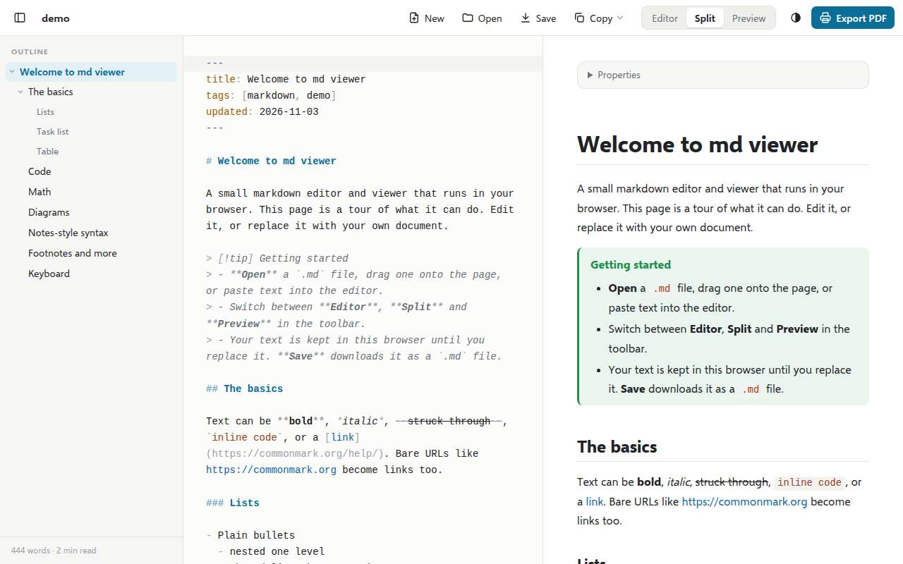

# md viewer

A small markdown editor and viewer for the browser. Open or paste a document, read it with
a heading outline beside it, edit it, and export it as a PDF. It is a static page with no
backend: documents stay in your browser.



## Features

- **Three views:** Editor, Split (editor and preview scroll together) and Preview.
- **Outline** of the headings on the left. Click to jump, the current section is
  highlighted, and branches fold.
- **Open, paste or drag-drop** a `.md` file; **Save** downloads it. The current document
  autosaves in the browser.
- **Copy** the whole document as markdown, rich text (pastes formatted into email or docs)
  or HTML. Every code block has its own copy button.
- **Export PDF** through the browser's print dialog. The print stylesheet drops the app's
  toolbar, prints in light colors, and keeps code blocks, tables and diagrams on one page.
- GitHub-flavored markdown (tables, task lists, footnotes), code highlighting, KaTeX math
  and Mermaid diagrams.
- Notes-style syntax: YAML front matter shown as a properties box, `[[wikilinks]]`, and
  `> [!note]` callouts (foldable with `-` or `+`).
- Light and dark theme, and a phone layout.

## How it works

Plain HTML, CSS and ES-module JavaScript in `site/`, with no build step. The libraries are
pinned and vendored into `site/vendor/` by `scripts/fetch-vendor.sh`, so the page never
loads code from a CDN.

| File | Role |
|---|---|
| `site/app.js` | Wiring: editor, views, file actions, copy, print |
| `site/render.js` | Markdown → sanitized HTML: front matter, wikilinks, callouts, code blocks, Mermaid |
| `site/outline.js` | The heading tree |
| `site/scroll-sync.js` | Split-view scroll sync, using the source line of each block |
| `site/styles.css`, `site/print.css` | Screen and PDF styles |

Libraries: [markdown-it](https://github.com/markdown-it/markdown-it) with footnote,
task-list and texmath plugins, [DOMPurify](https://github.com/cure53/DOMPurify),
[CodeMirror 5](https://codemirror.net/5/), [highlight.js](https://highlightjs.org/),
[KaTeX](https://katex.org/) and [Mermaid](https://mermaid.js.org/). Their licenses are in
`site/vendor/`.

## Run locally

```bash
python3 -m http.server 8031 --directory site
```

Then open <http://localhost:8031>.

## Deploy

It runs on my homelab as a small nginx container (non-root, read-only filesystem, 64 MB
memory limit) on port 8031, reachable on the LAN and tailnet only.

```bash
./deploy.sh
```

The script rsyncs the repo to the Docker host and runs `docker compose up -d --build`.
There are no environment variables and no volumes, because nothing is stored on the server.

To update a library, change its version in `scripts/fetch-vendor.sh`, run the script, and
commit `site/vendor/`.
