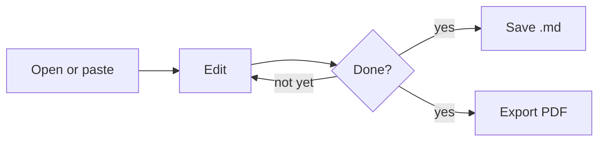

# Welcome to md viewer

A small markdown editor and viewer that runs in your browser. This page is a tour of what it can do. Edit it, or replace it with your own document.

> [!tip] Getting started
> - **Open** a `.md` file, drag one onto the page, or paste text into the editor.
> - Switch between **Editor**, **Split** and **Preview** in the toolbar.
> - Your text is kept in this browser until you replace it. **Save** downloads it as a `.md` file.

## The basics

Text can be **bold**, *italic*, ~~struck through~~, `inline code`, or a [link](https://commonmark.org/help/). Bare URLs like https://commonmark.org become links too.

### Lists

- Plain bullets
  - nested one level
- Numbered lists keep counting:
  1. First
  2. Second

### Task list

- [x] Write the outline
- [ ] Export to PDF

### Table

| Feature | Where | Note |
|---|:---:|---|
| Outline | left | click a heading to jump |
| Split view | toolbar | editor and preview scroll together |
| PDF | Export PDF | print dialog → Save as PDF |

## Code

```python
from math import cos, radians

def vmg(boat_speed: float, twa_deg: float) -> float:
    """Velocity made good towards the wind."""
    return boat_speed * cos(radians(twa_deg))
```

Every code block has a **Copy** button.

## Math

Inline math like $E = mc^2$, and display math:

$$
\int_0^\infty e^{-x^2}\,dx = \frac{\sqrt{\pi}}{2}
$$

## Diagrams



## Notes-style syntax

Wiki links are styled like in your notes: [[Sailing log]], [[Race notes|an alias]], and [[#Code|a link to a heading on this page]].

> [!note]
> Callouts work like in Obsidian. Types include note, tip, warning, danger, question and quote.

> [!warning] Heads-up
> Your document lives in this browser only. Clearing the site's data removes it.

> [!question]- A foldable callout (click to open)
> Put `-` (closed) or `+` (open) after the type to make a callout foldable.

The **Properties** box at the top comes from the YAML front matter.

## Footnotes and more

A footnote reference[^1] and a keyboard hint: <kbd>⌘</kbd> + <kbd>S</kbd>.

[^1]: Footnotes are collected at the bottom of the document.

## Keyboard

| Shortcut | Action |
|---|---|
| ⌘/Ctrl + S | Save as `.md` |
| ⌘/Ctrl + O | Open a file |
| ⌘/Ctrl + F | Find in the editor |
| ⌘/Ctrl + P | Print or PDF |
